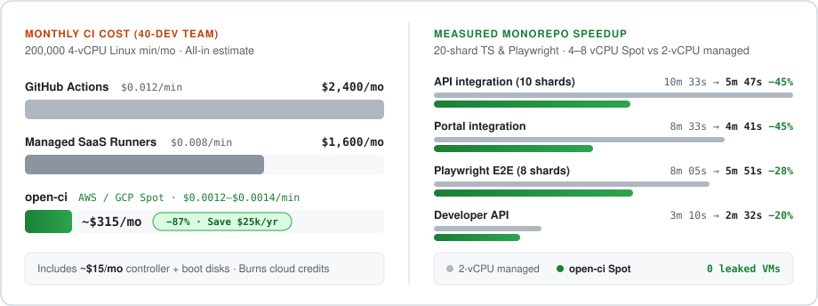
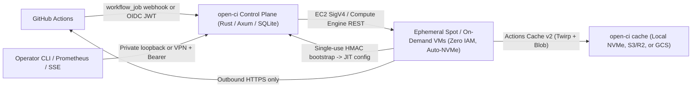

<p align="center">
  <picture>
    <source media="(prefers-color-scheme: dark)" srcset="docs/assets/logo-dark.svg">
    <source media="(prefers-color-scheme: light)" srcset="docs/assets/logo-light.svg">
    
  </picture>
</p>

<h3 align="center">Cut GitHub Actions compute costs by up to 90% and speed up builds — on your own AWS &amp; GCP Spot VMs.</h3>

<p align="center">
  A single Apache-2.0 Rust binary that runs ephemeral self-hosted GitHub Actions runners with built-in transparent Actions v2 caching, auto-NVMe RAID0 scratch disks, zero cloud IAM on workers, and fail-closed routing.
</p>

<p align="center">
  <a href="https://github.com/katchlabs/open-ci/actions/workflows/ci.yml"></a>
  <a href="https://github.com/katchlabs/open-ci/releases/latest"></a>
  <a href="LICENSE"></a>
  <a href="rust-toolchain.toml"></a>
</p>

<p align="center">
  <a href="#try-it-locally-in-30-seconds">Try Locally</a> ·
  <a href="#cost-savings--benchmarks">Cost &amp; Benchmarks</a> ·
  <a href="#wire-your-workflow">Workflow Setup</a> ·
  <a href="#how-open-ci-compares">Compare</a> ·
  <a href="docs/quickstart.md">Deploy to AWS / GCP</a> ·
  <a href="docs/security.md">Security</a>
</p>

<p align="center">
  <picture>
    <source media="(prefers-color-scheme: dark)" srcset="docs/assets/savings-dark.svg">
    <source media="(prefers-color-scheme: light)" srcset="docs/assets/savings-light.svg">
    
  </picture>
</p>

<p align="center">
  <sub>Late-2026 4-vCPU Linux rates (AWS/GCP Spot + ~$15/mo controller) and measured 20-shard TypeScript &amp; Playwright monorepo timings. See <a href="#cost-savings--benchmarks">full breakdown</a>.</sub>
</p>

---

## Why `open-ci`?

- **85–90% lower compute spend, zero SaaS tax.** Pay raw AWS and GCP Spot (or On-Demand) rates, burn existing cloud credits, and run the entire control plane on a single `~$12–$15/mo` VM (`t4g.small` or `e2-small`). Zero per-seat fees, zero cache markup.
- **Faster builds out of the box.** Ships with a native **GitHub Actions Cache v2** server (`open-ci cache`, verified against the official `@actions/cache` client) backed by local NVMe, S3/R2/MinIO, or native GCS with keyless VM credentials and an optional bounded RAM hot tier (`hot_cache_bytes`) — plus boot-time auto-NVMe `ext4`/RAID0 mounting for Docker layers, `RUNNER_WORKDIR`, and `TMPDIR`.
- **Drop-in or fail-closed routing.** Change a single line (`runs-on: open-ci-linux-x64`) with `admission.mode = "webhook"`, or route via [`katchlabs/open-ci/actions/route@v0.2.1`](actions/route) in `oidc` / `hybrid` mode so controller downtime, drains, reruns, or capacity limits fall back cleanly to `ubuntu-latest` without breaking CI.
- **Multi-cloud without Kubernetes or CLI bloat.** Pure-Rust AWS EC2 + STS SigV4/XML and GCP Compute Engine REST adapters spill automatically across regions, families, and clouds on Spot stockout. Native keyless cloud identity (`IMDSv2`, STS `AssumeRole` + `ExternalId`, GCE metadata, IAM SA impersonation, and keyless GCP→AWS web identity federation) plus org-wide multi-repo pools.
- **Zero-IAM, hard-bounded workers.** Every ephemeral runner boots with zero cloud IAM (`serviceAccounts: []` on GCP; no instance profile + IMDSv2 enforced on AWS), zero inbound ports, single-use atomic HMAC bootstrap tokens, and triple-layer hard expiry (`reconciler` + `maxRunDuration`/`open-ci-aws-janitor` + guest `poweroff`).
- **Single binary, strict Rust safety.** Compiles to static-friendly `x86_64` and `aarch64` Linux binaries and multi-arch GHCR containers under `unsafe_code = "forbid"`, `clippy::unwrap_used = "deny"`, `expect_used = "deny"`, and `panic = "deny"`.

---

## Try It Locally in 30 Seconds

Run the full control plane locally against `MockProvider` — no AWS, GCP, or GitHub App required.

```bash
# Option A: Multi-arch container (linux/amd64, linux/arm64)
docker run --rm -p 8080:8080 ghcr.io/katchlabs/open-ci:latest demo --listen 0.0.0.0:8080

# Option B: Prebuilt Linux release binary (x86_64 or aarch64)
curl -fsSL https://github.com/katchlabs/open-ci/releases/latest/download/open-ci-x86_64-unknown-linux-gnu.tar.gz \
  | tar -xz -C /usr/local/bin
open-ci demo --listen 127.0.0.1:8080

# Option C: Build from source (Rust 1.89+)
cargo run --bin open-ci -- demo --listen 127.0.0.1:8080
```

In a second terminal, query live control-plane state, metrics, and events:

```bash
export OPEN_CI_URL="http://127.0.0.1:8080"
export OPEN_CI_OPERATOR_TOKEN="demo-operator-token-000000000000"

open-ci ctl status
open-ci validate --config config/open-ci.example.toml
```

<details>
<summary>Inspect example <code>open-ci ctl status</code> output, Prometheus metrics, SSE stream, and drain controls</summary>

```json
{
  "active_backoffs": 0,
  "admission_mode": "hybrid",
  "capacity": {
    "held_admissions": 0,
    "limit": { "disk_gb": 300, "instances": 8, "vcpu": 16 },
    "reserved": { "disk_gb": 20, "instances": 1, "vcpu": 2 }
  },
  "control": {
    "mode": "active",
    "reason": "initial",
    "updated_at": 0,
    "updated_by": "system"
  },
  "organization": null,
  "pools_configured": 1,
  "repository": "example/repo",
  "scope": "example/repo",
  "timestamp": 1763916000,
  "workers": { "active": 0, "by_phase": {}, "by_provider": {} }
}
```

```bash
curl -sS -H "Authorization: Bearer $OPEN_CI_OPERATOR_TOKEN" "$OPEN_CI_URL/metrics"
curl -sS -N -H "Authorization: Bearer $OPEN_CI_OPERATOR_TOKEN" "$OPEN_CI_URL/api/v1/events"
open-ci ctl set-mode draining --reason "maintenance"
open-ci ctl set-mode active --reason "resume"
```

</details>

---

## Wire Your Workflow

Pick the admission mode that matches your team — or set `admission.mode = "hybrid"` to migrate incrementally across an entire GitHub organization (`organization` + `allowed_repositories` + `runner_group_id`).

### Option A: Zero-Friction Drop-In (`admission.mode = "webhook"`)

Point a GitHub `workflow_job` webhook at `https://<your-domain>/v1/ingress/webhook` and change one line:

```yaml
jobs:
  build:
    runs-on: open-ci-linux-x64
    steps:
      - uses: actions/checkout@v4
      - run: cargo test --workspace
```

### Option B: Fail-Closed OIDC Routing (`admission.mode = "oidc"` or `"hybrid"`)

A lightweight routing step exchanges a GitHub OIDC JWT for a scoped runner label. If your controller is unreachable, draining, at capacity, or handling a rerun, jobs fall back automatically to `ubuntu-latest` — CI never blocks on infrastructure:

```yaml
jobs:
  route:
    runs-on: ubuntu-latest
    permissions:
      id-token: write
      contents: read
    outputs:
      runners: ${{ steps.route.outputs.runners }}
    steps:
      - id: route
        uses: katchlabs/open-ci/actions/route@v0.2.1
        with:
          endpoint: https://ci.example.com/v1/ingress/admit
          audience: open-ci:example-org/example-repo
          pools: '["default"]'
          fallbacks: '{"default": "ubuntu-latest"}'

  build:
    needs: route
    runs-on: ${{ fromJSON(needs.route.outputs.runners).default }}
    steps:
      - uses: actions/checkout@v4
      - run: cargo test --workspace
```

---

## Cost Savings & Benchmarks

### Per-Minute Compute Rates (4-vCPU Linux)

| Runner Option | Spec / Instance | Per-Minute | Per-Hour | vs. GitHub Actions |
| --- | --- | ---: | ---: | ---: |
| GitHub Actions (x64) | 4 vCPU Linux x64 | `$0.0120/min` | `$0.720/hr` | baseline |
| Managed Runner SaaS (e.g. Blacksmith) | 4 vCPU Linux x64 | `$0.0080/min` | `$0.480/hr` | −33% |
| **`open-ci` · AWS Spot (x64)** | `c7a.xlarge` (4 vCPU / 8 GiB, `us-east-1`) | **`~$0.0014/min`** | **`~$0.085/hr`** | **~88% cheaper** |
| **`open-ci` · GCP Spot (x64)** | `c3-standard-4` (4 vCPU / 16 GiB, `us-central1`) | **`~$0.0012/min`** | **`~$0.072/hr`** | **~90% cheaper** |
| **`open-ci` · AWS Graviton Spot (ARM64)** | `c7g.xlarge` (4 vCPU / 8 GiB) | **`~$0.0012/min`** | **`~$0.072/hr`** | **~85% cheaper** *(vs. `$0.008/min` GH ARM64)* |

<sub>Control plane overhead: one small VM (`e2-small` or `t4g.small`) = <strong>~$12–$15/mo flat</strong>.</sub>

### Monthly All-In Cost by Team Size

Estimates include the ~$15/mo controller VM and ephemeral boot disks. All compute stays on your own AWS/GCP bill (eligible for cloud credits) with zero per-seat fees or cache storage markup.

| Team Profile | Monthly Volume | GitHub Actions | Managed SaaS | **`open-ci` (All-In)** | Annual Savings vs. GitHub |
| --- | --- | ---: | ---: | ---: | ---: |
| **Startup** (10 devs) | 40k 4-vCPU min/mo | `$480/mo` | `$320/mo` | **`~$75/mo`** | **`~$4,860/yr` (84%)** |
| **Growth Team** (40 devs) | 200k 4-vCPU min/mo | `$2,400/mo` | `$1,600/mo` | **`~$315/mo`** | **`~$25,020/yr` (87%)** |
| **Monorepo Scale** (150 devs) | 500k 8-vCPU min/mo | `$11,000/mo` *(at `$0.022/min`)* | `$8,000/mo` *(at `$0.016/min`)* | **`~$1,450/mo`** | **`~$114,600/yr` (87%)** |

### Measured Monorepo Speedup

20-shard TypeScript & Playwright monorepo running on **4–8 vCPU GCP Spot** via `open-ci` vs. **2-vCPU managed runners**:

| Test Suite | 2-vCPU Managed | **`open-ci` (4–8 vCPU Spot)** | Speedup |
| --- | ---: | ---: | ---: |
| API integration tests (10 shards) | `10m 33s` | **`5m 47s`** | **45% faster** |
| Portal integration suite | `8m 33s` | **`4m 41s`** | **45% faster** |
| Playwright browser E2E (8 shards) | `8m 05s` | **`5m 51s`** | **28% faster** |
| Developer API suite | `3m 10s` | **`2m 32s`** | **20% faster** |
| Leaked Spot VMs after completion | — | **`0`** | — |

---

## How `open-ci` Compares

| Capability | **`open-ci`** | GitHub-Hosted | Managed Runner SaaS | Kubernetes ARC |
| --- | --- | --- | --- | --- |
| **License** | **Apache-2.0 (100% OSS)** | Proprietary | Proprietary | Apache-2.0 |
| **4-vCPU Linux Cost** | **`~$0.0012–$0.0014/min`** | `$0.012/min` | `$0.008/min` | Cloud cost + K8s cluster |
| **Cloud Support** | **AWS + GCP (multi-cloud)** | GitHub only | Vendor cloud | Any K8s cluster |
| **Infra Required** | **1 small VM (`~$15/mo`)** | None | None | Full Kubernetes cluster + ops |
| **Built-in Actions v2 Cache** | **Yes (NVMe / S3 / R2 / GCS)** | 10 GiB limit / billed | Proprietary add-on | DIY |
| **VM Isolation & Zero IAM** | **Fresh VM per job, zero IAM** | Fresh VM per job | Shared vendor plane | Shared node kernel (pods) |
| **Fail-Closed Fallback** | **Built-in (`actions/route`)** | N/A | Manual | Manual |
| **Burns AWS / GCP Credits** | **Yes** | No | No | Yes |

---

## How It Works



### Deploy to Production

Ready for AWS, GCP, or multi-cloud failover? Turnkey modules and release artifacts are included:

- **Prebuilt binaries & AWS janitor Lambda zips:** [`github.com/katchlabs/open-ci/releases/latest`](https://github.com/katchlabs/open-ci/releases/latest) (`x86_64` & `aarch64` Linux)
- **Terraform modules (`infra/terraform`):** [`aws-controller`](infra/terraform/examples/aws-controller/main.tf), [`gcp-quickstart`](infra/terraform/examples/gcp-quickstart/main.tf), and [`multi-cloud`](infra/terraform/examples/multi-cloud/main.tf) (with keyless GCP→AWS web identity federation)
- **Packer runner images (`infra/packer`):** Unified Ubuntu 24.04 `x64`/`arm64` template with pinned `actions/runner`, Docker BuildKit, sysctl tuning, and boot-time auto-NVMe RAID0
- **Step-by-step or 1-command install:** Run [`deploy/install.sh`](deploy/install.sh) (or `open-ci init` interactively) or follow the [**Deployment Quickstart**](docs/quickstart.md)

---

## Honest Tradeoffs & Non-Goals

We prefer clear engineering boundaries over marketing claims:

- **Single-node SQLite control plane today.** `open-ci-store` uses SQLite in WAL mode with `fs2` single-writer fencing and online snapshots. One small controller VM (`t4g.small` / `e2-small`) comfortably drives hundreds of concurrent runners, and fail-closed `actions/route` keeps CI green during controller maintenance — active-active multi-node HA awaits the planned `PostgresStore`.
- **Linux runners only today.** Packer images and `open-ci agent bootstrap` target `x86_64` and `aarch64` Ubuntu Linux VMs. macOS and Windows runners are out of scope for now.
- **When GitHub-hosted is simpler.** If your CI bill is small, standard runners are fast enough, and you don't need private VPC access, Spot instances, local NVMe scratch disks, or self-hosted Actions v2 caching, GitHub-hosted runners have zero operational overhead.
- **Purpose-built for GitHub Actions.** `open-ci` orchestrates ephemeral VM fleets for GitHub Actions — it is not a general-purpose batch scheduler or Kubernetes replacement.

---

## Roadmap

| Status | Milestone | Details |
| :---: | --- | --- |
| ✓ | Multi-cloud AWS + GCP Spot & On-Demand | Pure-Rust SigV4/XML EC2 + Compute Engine REST |
| ✓ | Org-wide & multi-repo runner pools | `organization`, `allowed_repositories`, `runner_group_id` |
| ✓ | `webhook`, `oidc`, and `hybrid` admission | Drop-in webhooks or fail-closed `actions/route@v0.2.1` |
| ✓ | Native Actions Cache v2 (`open-ci cache`) | Local NVMe, S3/R2/MinIO, native GCS; verified with `@actions/cache` |
| ✓ | Auto-NVMe RAID0/ext4 & BuildKit tuning | `x64` & `arm64` Ubuntu 24.04 Packer templates |
| ✓ | Keyless BYOC cloud identity | `IMDSv2`, STS `AssumeRole` + `ExternalId`, GCE metadata, SA impersonation, GCP→AWS federation |
| ✓ | Turnkey Terraform & multi-arch releases | `aws-controller`, `gcp-controller`, GHCR + `.tar.gz` + Lambda zips |
| ✓ | Bare-metal / nested-KVM microVMs | Pure-Rust `open-ci-provider-ch` (Cloud Hypervisor + XFS reflink CoW rootfs + auto-spillover) |
| ✓ | Zero-friction CLI setup & preflight | `open-ci init` preset generator, `open-ci doctor`, and single-process `open-ci serve --with-cache` |
| ○ | `PostgresStore` for active-active HA | Same async `Store` trait; zero domain changes |
| ○ | Operator Web UI | Backed by existing `/api/v1/*` REST + `/api/v1/events` SSE |
| ○ | Additional cloud providers | Hetzner, Azure, Kubernetes via `CloudProvider` trait |

---

<details>
<summary><strong>Workspace &amp; Infrastructure Map (12 Rust Crates + IaC)</strong></summary>

| Path | Responsibility |
| --- | --- |
| `crates/open-ci-core` | Zero-I/O domain core: typed TOML config + validation, worker state machine, admission capacity math, placement selection, regional quota backoff, `SecretString`, `Clock`. |
| `crates/open-ci-store` | Async `Store` trait and non-blocking normalized `SQLite` backend (`spawn_blocking`, WAL, `0o600` pre-creation, `fs2` exclusive lockfile, online backup snapshots). |
| `crates/open-ci-provider` | Cloud-agnostic `CloudProvider` trait, typed `ProviderError`, `InstanceSpec`, and `ProviderRegistry`. |
| `crates/open-ci-provider-aws` | Pure-Rust AWS EC2 + STS adapter (SigV4 signing, XML parsing, Spot/On-Demand, hardware placement tuning, IMDSv2, cross-account `AssumeRole` with `ExternalId`, GCP→AWS web identity). |
| `crates/open-ci-provider-gcp` | Native Rust GCP Compute Engine REST adapter (Spot/On-Demand, Hyperdisk/Local SSD/gVNIC/Tier-1 tuning, `maxRunDuration`, `serviceAccounts: []`, GCE metadata & IAM impersonation). |
| `crates/open-ci-provider-ch` | Pure-Rust Cloud Hypervisor microVM provider over Unix socket REST API with XFS reflink CoW rootfs clones, per-VM `/dev/vdb` seed injection, and optional physical-core pinning. |
| `crates/open-ci-provider-mock` | Deterministic fault-injecting provider for tests and `open-ci demo`. |
| `crates/open-ci-github` | Typed GitHub REST client (bounded pagination, repo & org JIT registration), constant-time HMAC webhook verifier, RS256 OIDC JWT verifier, privilege-separated credential broker. |
| `crates/open-ci-server` | Non-blocking `ControlPlane`, event-driven + periodic reconciler, public machine ingress, authenticated Operator API, SSE stream, and Prometheus `/metrics`. |
| `crates/open-ci-cache` | Native GitHub Actions v2 transparent cache server (Twirp RPCs + Azure block blob protocol): runtime-token auth with ref-scoped entries, `SQLite` index with retention, bounded RAM hot tier (`HotMemoryBlobStore`), zero-copy local block manifests, streaming `local`/`s3`/`gcs` blob stores, and results-service passthrough. |
| `crates/open-ci-aws-janitor` | Standalone Rust CLI and AWS Lambda (`provided.al2023`) expiry guard that terminates leaked EC2 instances and detached EBS volumes with per-resource fault isolation. |
| `crates/open-ci-cli` | Unified CLI binary (`serve`, `cache`, `demo`, `validate`, `ctl`, `backup`, `rotate-credentials`, `agent bootstrap`). |
| `actions/route` | Zero-dependency TypeScript (`node24`) GitHub Action for fail-closed OIDC admission routing. |
| `infra/terraform` | Turnkey modules (`gcp-foundation`, `gcp-controller`, `aws-foundation`, `aws-controller`) and examples (`gcp-quickstart`, `aws-controller`, `multi-cloud`). |
| `infra/packer` | Unified GCP + AWS Packer template (`ubuntu-runner.pkr.hcl`) for `x64`/`arm64` Ubuntu 24.04 runners with boot-time auto-NVMe (`setup-nvme.sh`), Docker BuildKit, and sysctl tuning. |
| `infra/cloud-hypervisor` | Bare-metal / nested-KVM Ubuntu 24.04 host setup (`setup-host.sh`) and sparse ext4 rootfs + kernel builder (`build-rootfs.sh`). |
| `deploy/` | Hardened systemd units (`open-ci.service`, `open-ci-cache.service`, `open-ci-credentials.timer`, `open-ci-backup.timer`), Caddy reverse proxy template, and multi-stage Dockerfile. |

</details>

---

## Documentation

- [**Deployment Quickstart**](docs/quickstart.md) — End-to-end AWS-only, GCP-only, or multi-cloud deployment with Terraform, Packer, systemd, and Caddy.
- [**Architecture Guide**](docs/architecture.md) — Hexagonal crate layout, concurrency model, SQLite durability, multi-cloud scheduling, cache/NVMe pipeline, and exact HTTP API specification.
- [**Security & Threat Model**](docs/security.md) — Zero-IAM runners, atomic single-use bootstrap, OIDC pinning, credential broker isolation, triple-layer expiry, and BYOC trust boundaries.
- [**Engineering & Trust Loop**](docs/engineering.md) — Pyramid of Trust, `.agents/skills/`, reusable runtime + SQLite driver, and the 7-gate `./scripts/verify.sh` proof ladder.
- [**Contributing**](CONTRIBUTING.md) — Standards, local verification, and PR workflow.
- [**Security Policy**](SECURITY.md) — Private vulnerability disclosure process.

## License

Built by [Katch Labs](https://github.com/katchlabs). Licensed under the [Apache License, Version 2.0](LICENSE).
