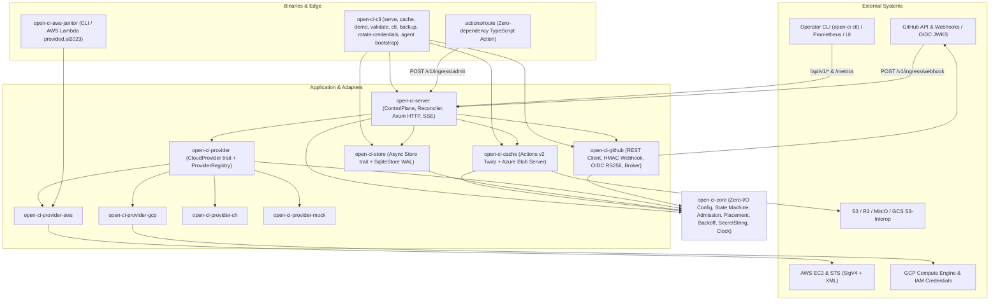
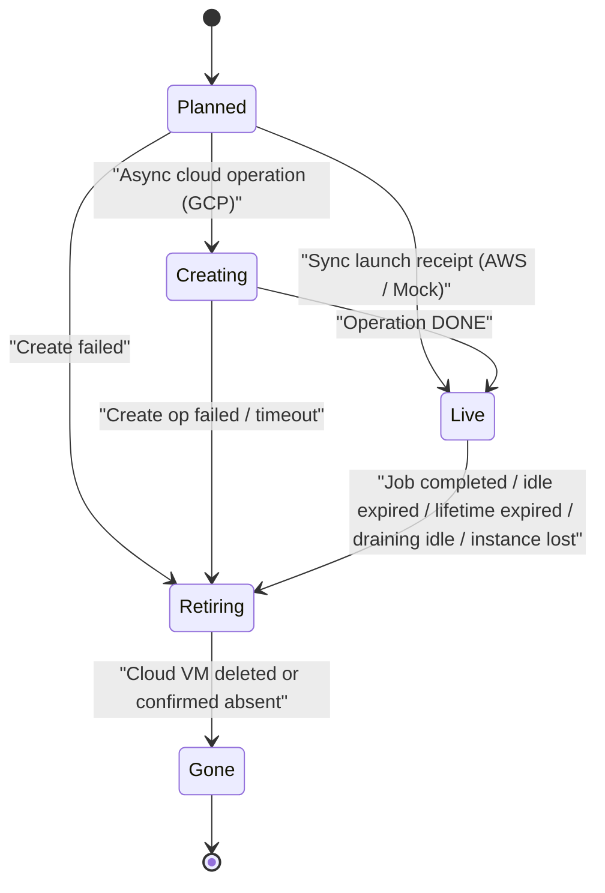

# open-ci Architecture

`open-ci` is a modular Rust workspace structured around strict hexagonal (ports-and-adapters) boundaries. Pure domain logic lives in `open-ci-core` with zero network, filesystem, or async runtime dependencies; persistence, cloud APIs, GitHub integration, HTTP ingress, caching, and expiry enforcement live in dedicated adapter crates.

---

## Hexagonal System Diagram



---

## Crate Responsibilities (12 Workspace Crates)

Workspace-wide lints in `Cargo.toml` enforce `unsafe_code = "forbid"`, `clippy::unwrap_used = "deny"`, `clippy::expect_used = "deny"`, `clippy::panic = "deny"`, `clippy::todo = "deny"`, `clippy::unimplemented = "deny"`, and `clippy::pedantic = "warn"`.

| Crate | Role | Key Types & Guarantees |
| --- | --- | --- |
| `open-ci-core` | Pure zero-I/O domain model | `OpenCiConfig` (`#[serde(deny_unknown_fields)]`), `GitHubScope`, `AdmissionMode`, `evaluate_admission`, `evaluate_webhook_admission`, `WorkerPhase` state machine, `evaluate_retirement`, `plan_scale_up`, `select_placement`, `SecretString`, `Clock` / `ManualClock`. Verified with `proptest` in `tests/invariants.rs`. |
| `open-ci-store` | Durable async state storage | `Store` trait and `SqliteStore` using `tokio::task::spawn_blocking`, WAL mode, `fs2` exclusive lockfile fencing, `0o600` pre-creation, monotonic phase/status upserts, normalized migrations, and consistent online backups. |
| `open-ci-provider` | Cloud provider port | `CloudProvider` trait (`create_instance`, `get_operation`, `delete_instance`, `list_instances`, `list_orphan_disks`, `delete_disk`, `health_check`), `InstanceSpec`, `ProviderError`, `ProviderRegistry`. |
| `open-ci-provider-aws` | Native AWS EC2 & STS adapter | Pure-Rust SigV4 signing (`sigv4.rs`), EC2 Query API params (`params.rs`), XML response parsing (`xml.rs`), Spot & On-Demand launch, hardware placement tuning, IMDSv2 enforcement, `AwsCredentialChain` (`Env` → `IMDSv2` → optional STS `AssumeRole` with `ExternalId`). |
| `open-ci-provider-gcp` | Native GCP Compute Engine adapter | Direct Compute Engine REST JSON client, Spot & On-Demand VMs, Hyperdisk/Local SSD/gVNIC/Tier-1/SMT controls, `maxRunDuration` + `instanceTerminationAction: DELETE`, `serviceAccounts: []`, Shielded VM config, `FileTokenSource` / `MetadataTokenSource` / `ImpersonatedTokenSource` (IAM Credentials API). |
| `open-ci-provider-ch` | Native Cloud Hypervisor adapter | Pure-Rust Unix-socket HTTP/1.1 client for `cloud-hypervisor` microVMs, XFS reflink CoW rootfs clones, `0o600` `/dev/vdb` bootstrap seed images, TAP/bridge networking, and optional physical-core pinning. |
| `open-ci-provider-mock` | Deterministic test & demo provider | In-memory fault-injecting `MockProvider` supporting quota/stockout simulation, used in integration tests and `open-ci demo`. |
| `open-ci-github` | GitHub integration & security | Bounded-pagination REST client supporting repo-level and org-level JIT registration (`runner_group_id`), constant-time HMAC-SHA256 webhook verification, RS256 OIDC JWT verifier with lock-free singleflight JWKS refresh, and privilege-separated `rotate_credentials` broker. |
| `open-ci-server` | Control plane & HTTP server | Non-blocking `ControlPlane`, event-driven + periodic reconciler with bounded parallel scale-up (`buffer_unordered(8)`), single-use HMAC bootstrap handler, public machine ingress, bearer-authenticated Operator API, SSE broadcast stream, and Prometheus metrics. |
| `open-ci-cache` | Native Actions v2 cache server | Axum server implementing GitHub Actions Cache v2 Twirp RPCs and Azure-compatible single-shot/block blob endpoints, runtime-token authorization with ref-scoped immutable entries, signed capability URLs, `SQLite` index with retention, optional bounded RAM `HotMemoryBlobStore`, zero-copy local block manifests, streaming `local`/`s3`/`gcs` `BlobStore` backends, and results-service passthrough. |
| `open-ci-aws-janitor` | Independent AWS expiry guard | Standalone Rust CLI and AWS Lambda (`provided.al2023` custom runtime loop) sweeping expired `open-ci-managed=true` EC2 instances and detached EBS volumes with per-resource error isolation and fail-closed tag parsing. |
| `open-ci-cli` | Thin CLI & worker agent binary | Subcommands: `serve`, `cache`, `demo`, `validate`, `ctl`, `backup`, `rotate-credentials`, `agent bootstrap`. |

---

## Non-Blocking Concurrency Model

`open-ci-server` is designed so slow cloud API calls, disk fsyncs, or JWKS refreshes never stall unrelated HTTP requests or reconciliation:

1. **No global controller mutex.** `ControlPlane` holds shared `Arc` handles (`store`, `providers`, `github`, `oidc`, `clock`, `secrets`, `events`). Read endpoints (`/api/v1/*`, `/healthz`, `/readyz`, `/metrics`) and worker bootstrap never contend on a global lock.
2. **Fine-grained admission serialization.** Only run admission acquires `admission_tx: Arc<Mutex<()>>`, and provider health checks run *before* acquiring that lock. This guarantees atomic, race-free capacity envelope checks across concurrent workflow runs without blocking reconciler cloud calls.
3. **Async-safe SQLite.** Every `rusqlite` call in `SqliteStore` runs inside `tokio::task::spawn_blocking` guarded by a synchronous `std::sync::Mutex<Connection>`, keeping Tokio worker threads free from disk I/O and WAL checkpoints.
4. **Lock-free JWKS reads with singleflight refresh.** `OidcVerifier` serves cached keys under a `tokio::sync::RwLock` and coalesces concurrent JWKS refreshes behind a dedicated `refresh_lock` with a 30-second forced-refresh cooldown and 64 KiB response cap.
5. **Reconciler & graceful shutdown.** `open-ci serve` spawns a background reconciler loop (`server.tick_seconds`, default 5s) paired with Axum via a shared `tokio_util::sync::CancellationToken`. On `SIGINT`/`SIGTERM`, HTTP draining and the background reconciler stop cleanly.
6. **Live event fan-out.** State transitions (mode changes, admissions, worker phases, backoffs) emit `ControlEvent` items onto a 512-slot `tokio::sync::broadcast` channel streamed to operators over `GET /api/v1/events` (SSE with 15s keepalive).

---

## SQLite Persistence, Fencing & Online Backups

`open-ci-store` persists all control-plane state in a normalized SQLite database configured with:

```sql
PRAGMA journal_mode = WAL;
PRAGMA synchronous = FULL;
PRAGMA foreign_keys = ON;
PRAGMA busy_timeout = 5000;
```

- **Tables:** `schema_migrations`, `control_state` (singleton row `id = 1`), `pool_state` (routing cursor & last discovery timestamp), `admissions` (unique on `(repository, run_id, run_attempt)`), `workers` (unique `request_id`, monotonic phase, `bootstrap_used` flag), `jobs`, `worker_usage`, `placement_backoffs` (primary key `(provider, region, family)`), and `audit_log`.
- **Single-writer fencing:** Opening `SqliteStore` acquires an exclusive `fs2` OS lock on `<database_path>.lock`, preventing two `open-ci serve` processes from writing the same database simultaneously.
- **No permission TOCTOU:** The database file, lockfile, `-wal`, and `-shm` sidecars are pre-created and enforced with `0o600` permissions on Unix.
- **Consistent online backups:** `open-ci backup --config ... --output ...` opens the live database read-only (`SQLITE_OPEN_READ_ONLY`) without colliding with the writer lockfile, runs SQLite's Online Backup API (`128` pages per step), writes to a `0o600` temporary file, and atomically renames it into place.
- **Idempotent launch intent:** Before calling a cloud provider's create API, the reconciler persists a `Planned` worker row with a UUID `request_id` (passed as AWS `ClientToken` / tracked across restarts), so crashes mid-launch cannot create unaccounted workers.

---

## Admission Modes, GitHub Scope & Capacity Accounting

### GitHub Scope (Single-Repo or Org-Level)

Configure either:
- `repository = "owner/repo"` for a single repository, or
- `organization = "my-org"` with `allowed_repositories = ["my-org/*"]` (or an explicit list such as `["my-org/api", "my-org/web"]`) and optional `github.runner_group_id` (defaults to `1`).

Both webhook verification and OIDC claim validation enforce `GitHubScope::allows_repository`.

### Admission Modes (`admission.mode`)

| Mode | Trigger | Runner Labels | Behavior |
| --- | --- | --- | --- |
| `"oidc"` (default) | `actions/route` calls `POST /v1/ingress/admit` with a GitHub OIDC JWT | Scoped per reservation (`<runner_label>-<reservation_id>`) | Fail-closed: outage, draining, reruns (`fallback_on_rerun = true`), unhealthy providers, or capacity exhaustion route cleanly to `pool.fallback_label`. |
| `"webhook"` | GitHub sends `workflow_job` (`queued`) to `POST /v1/ingress/webhook` | Unscoped (`pool.runner_label`) | Drop-in: zero workflow edits beyond `runs-on: <runner_label>`. Matching queued jobs auto-admit idempotently if guardrails and capacity allow. `/v1/ingress/admit` returns `403`. |
| `"hybrid"` | Both `POST /v1/ingress/admit` and `POST /v1/ingress/webhook` | Scoped for OIDC admissions; unscoped for direct webhook admissions | Supports gradual migration across repositories in the same organization. |

### Capacity Envelope & Guardrails

Every admitted run reserves the worst-case footprint of its requested pools (`sum(vcpu * per_run, instances * per_run, disk_gb * per_run)`, where `per_run = max_instances_per_run.unwrap_or(max_instances)`), added to `admission.background` (overhead reserved for the controller itself) and checked against `admission.capacity`. Optional `[admission.guardrails]` enforce `max_concurrent_runs`, `max_admitted_runs`, `max_admitted_runs_per_utc_day`, and `admit_until_unix`.

Control modes (`active`, `fallback-only`, `draining`, `paused`) are persisted in `control_state` and recorded in `audit_log`:
- `active` — Admits new runs and creates workers.
- `fallback-only` — Rejects new admissions (routes to fallback) while existing held runs finish normally.
- `draining` — Rejects new admissions, retires idle unbootstrapped workers immediately, lets busy workers finish until `lifetime_seconds`.
- `paused` — Halts new admissions and worker creation for emergency intervention.

---

## Multi-Cloud Placement, Backoff & Worker Lifecycle

Each pool defines one or more `[[pools.<id>.placements]]` across GCP and/or AWS regions, zones, machine types, and Spot (`spot = true`) vs. On-Demand (`spot = false`) pricing.

### Placement Selection (`open_ci_core::reconcile::select_placement`)

1. **Filter active backoffs:** Any placement whose `(provider, region, machine_family)` has an unexpired backoff is skipped.
2. **Weighted provider selection:** If `provider_weights` is configured (e.g. `gcp = 1, aws = 1`), the durable `routing_cursor` distributes launches across ready providers proportional to weight.
3. **Within-provider order:** If `prefer_cheapest = true`, selects the first ready placement in configured order (list cheapest placements first); otherwise round-robins across ready placements.

### Automatic Quota & Stockout Backoff

When a cloud launch fails, provider errors are classified deterministically:
- `ProviderError::QuotaExceeded` → 300-second regional `(provider, region, family)` backoff.
- `ProviderError::CapacityUnavailable` (Spot stockout / `InsufficientInstanceCapacity` / `SpotMaxPriceTooLow` / `Unsupported` instance type in the AZ / `ZONE_RESOURCE_POOL_EXHAUSTED`) → 90-second backoff.
- `ProviderError::RateLimited` → `retry_after_seconds` backoff (default 30s).

The next reconciler tick immediately spills demand onto healthy regions, families, or the secondary cloud.

### Monotonic Worker Phases



EC2 is eventually consistent: `DescribeInstances` can report `InvalidInstanceID.NotFound` for an instance `RunInstances` just created. A `Live` worker the provider cannot list (on AWS this includes `terminated` instances, which `get_instance` filters out) is treated as lost immediately once it has bootstrapped, and otherwise only after `LAUNCH_VISIBILITY_GRACE_SECONDS` (90s) from creation. A listed instance that is `stopping`/`shutting-down` retires immediately.

---

## Transparent Actions v2 Cache & Auto-NVMe Pipeline

### Transparent Cache (`open-ci-cache`)

When `[cache]` is configured in `open-ci.toml` and `OPEN_CI_CACHE_SIGNING_KEY_FILE` is set for `open-ci cache`:

1. For pools with `transparent_cache = true`, `open-ci-server` puts `cache_url` (= `cache.public_url`) in the worker's cloud-init stdin envelope. No cache credential is minted or shipped.
2. `open-ci agent bootstrap` renames the `ACTIONS_RESULTS_URL` UTF-16 literal in the runner's `bin/Runner.Worker.dll` to `ACTIONS_RESULTS_ORL` (same length), so the runner stops overwriting it per job, then starts the runner with `ACTIONS_CACHE_SERVICE_V2=true` and `ACTIONS_RESULTS_URL=<cache_url>/`. If the runner build lacks the literal, the agent skips the redirect and jobs keep GitHub's cache.
   **Limitation:** the runner forwards only its per-step environment into `container:` jobs and Docker container actions, so inside those containers `ACTIONS_RESULTS_URL` is absent once redirected (artifact uploads and caching fail there). Enable `transparent_cache` only on pools whose jobs run steps on the VM itself.
3. Official `actions/cache`, `setup-*` caching, `Swatinem/rust-cache`, and BuildKit `type=gha` call `open-ci cache` with the job's own `ACTIONS_RUNTIME_TOKEN`. The server verifies it (RS256 via the issuer JWKS, `iss`, `exp`, optional `aud`), requires its `repository_id` to be in `cache.auth.repositories`, and reads its `ac` ref grants.
4. Entries are immutable and keyed by `(repository_id, ref scope, version, key)`, exactly like GitHub: a job saves only into its writable ref (a PR writes `refs/pull/N/merge`, never `main`) and restores from its own ref first, then the read-only base/default refs; per ref it tries each key exact, then newest prefix. A duplicate save returns `409`.
5. Every other Twirp call (for example `ArtifactService`, used by `upload-artifact@v4`) is forwarded unchanged to `cache.upstream_results_url` (`https://results-receiver.actions.githubusercontent.com` by default).
6. Metadata lives in a `SQLite` index (`cache.index_path`). Archives stream through a pluggable `BlobStore` with an optional bounded RAM LRU tier (`cache.hot_cache_bytes`, `HotMemoryBlobStore` enforcing a unified committed + in-flight memory budget with lock-free concurrent reads):
   - **`local`** — local disk/NVMe directory with atomic `0o600` writes and zero-copy `.manifest` block assembly (avoids rewriting multi-part uploads on commit while pinning block file descriptors during reads).
   - **`s3`** — native SigV4 S3 API (AWS S3, R2, MinIO). Credentials: `instance` (IMDSv2 role, default), `environment`, or `assume_role`. Staged blocks are joined server-side with multipart `UploadPartCopy`. Add an `AbortIncompleteMultipartUpload` bucket lifecycle rule so uploads interrupted by a crash are reclaimed. R2 requires equal-sized parts, which holds for the toolkit's uniform block size but not for clients that stage uneven blocks.
   - **`gcs`** — native GCS JSON API. Credentials: `metadata` (VM service account, default), `impersonate`, or `token_file`. Staged blocks are joined server-side with `compose`.
7. Upload URLs accept bytes only while their reservation is live: after finalize (or once a reservation goes stale) every `PUT` is rejected, so a committed entry can never be rewritten. Block commits run to completion even if the client disconnects, block lists are capped at Azure's 50,000 blocks, and storage requests fail after 60 s without progress instead of hanging.
8. A background sweep (every `cache.retention.sweep_interval_seconds` and after each save) drops stale upload reservations, entries unused for `max_unused_days` (default 7, like GitHub), then least-recently-used entries until the total fits `max_total_bytes`, deleting their blobs.

### Boot-Time Auto-NVMe & Kernel Tuning (`infra/packer`)

Packer-built Ubuntu 24.04 images (`x64` and `arm64`) install `/usr/local/sbin/open-ci-setup-nvme.sh` as `open-ci-nvme.service` (`Before=docker.service`):

1. Resolves the root block device via `findmnt`/`lsblk` and explicitly excludes network-attached persistent volumes (`Elastic Block Store`, `PersistentDisk`, `Persistent Disk`, `Hyperdisk`, `nvme_card-pd`) and partitioned disks.
2. Uses a single local NVMe drive or stripes 2+ local NVMe drives into `/dev/md0` RAID0 (`mdadm --chunk=256`). Under `OPEN_CI_NVME_PAGE_CACHE=auto` (default), hosts with `>= 14 GiB` RAM mount an XFS-backed 4K-sector `ext4` image sized to 85% of the NVMe volume for page-cache-accelerated I/O; smaller VMs mount direct `ext4` (`-O ^has_journal`, `noatime,nodiratime`).
3. Mounts at `/mnt/nvme`, creates `/mnt/nvme/docker`, `/mnt/nvme/work`, `/mnt/nvme/tmp`, and rewrites `/etc/docker/daemon.json` to set `"data-root": "/mnt/nvme/docker"`.
4. `open-ci agent bootstrap` probes `/mnt/nvme/work` and `/mnt/nvme/tmp` for writability and injects `RUNNER_WORKDIR=/mnt/nvme/work` and `TMPDIR=/mnt/nvme/tmp`.
5. `/etc/sysctl.d/99-open-ci.conf` raises `fs.inotify.max_user_watches=524288`, `fs.inotify.max_user_instances=1024`, configures `fq` + `cubic` with 64 MiB max TCP buffers, and lowers `vm.swappiness=1`; Docker runs `overlay2` with BuildKit enabled and 10 concurrent pulls/pushes.

---

## Exact HTTP API Surface

### Control Plane — Public Ingress (`open-ci-server`)

Expose **only** these 6 routes through your TLS reverse proxy (see `deploy/caddy/Caddyfile.example`). Global request body limit is 1 MiB (512 bytes for `/usage`).

| Method | Path | Auth | Description |
| --- | --- | --- | --- |
| `GET` | `/healthz` | None | Liveness probe returning `200 OK` (`ok`). |
| `GET` | `/readyz` | None | Readiness probe verifying live SQLite connectivity (`{"status":"ready"}`). |
| `POST` | `/v1/ingress/webhook` | `X-Hub-Signature-256` (constant-time HMAC-SHA256) | GitHub `workflow_job` webhook ingress. Records job hints in `oidc` mode; auto-admits queued jobs in `webhook`/`hybrid` mode. |
| `POST` | `/v1/ingress/admit` | `Authorization: Bearer <GitHub OIDC JWT>` | Verifies RS256 OIDC JWT claims + workflow pinning and returns an idempotent `AdmissionDecision` (`200`), or `403` when `admission.mode = "webhook"`. |
| `POST` | `/v1/workers/{name}/bootstrap` | `Authorization: Bearer <bootstrap HMAC>` | Atomically burns single-use bootstrap capability (`bootstrap_used = 0 -> 1`) and returns ephemeral GitHub JIT config with `Cache-Control: no-store`. |
| `POST` | `/v1/workers/{name}/usage` | `Authorization: Bearer <usage HMAC>` | Records bounded Linux NIC `rx_bytes`/`tx_bytes` telemetry (512-byte body cap, valid only within worker lifetime + 120s). |

### Control Plane — Operator API (`open-ci-server`)

Keep bound to loopback (`127.0.0.1:8080`) or private VPN and block on the public reverse proxy. Requires `Authorization: Bearer <OPEN_CI_OPERATOR_TOKEN_FILE>` verified in constant time (returns `403` if `OPEN_CI_OPERATOR_TOKEN_FILE` is not configured). Optional CORS is restricted to `server.cors_allowed_origins` on this router only.

| Method | Path | Description |
| --- | --- | --- |
| `GET` | `/api/v1/overview` | Scope, admission mode, durable control mode, capacity envelope & reserved headroom, worker counts by phase/provider, active backoffs. |
| `GET` | `/api/v1/pools` | Configured pools, labels, architecture, sizing, placement counts, and active worker counts. |
| `GET` | `/api/v1/workers` | Active and historical workers (`?pool_id=<id>` optional filter). |
| `GET` | `/api/v1/jobs` | Observed GitHub jobs and routing status (`?pool_id=<id>` optional filter). |
| `GET` | `/api/v1/admissions` | Recent admission records (`?limit=<n>`, default 100, max 500). |
| `GET` | `/api/v1/backoffs` | Currently active regional quota/capacity/rate-limit backoffs. |
| `GET` | `/api/v1/audit` | Durable operator mutation audit log (`?limit=<n>`, default 100, max 500). |
| `POST` | `/api/v1/control/mode` | Transition control mode (`active`, `fallback-only`, `draining`, `paused`) with `actor` and `reason` (max 256 bytes each). |
| `POST` | `/api/v1/reconcile` | Trigger one immediate reconciliation pass and return `ReconcileSummary`. |
| `GET` | `/api/v1/events` | Server-Sent Events (`text/event-stream`) streaming live `control_event` JSON messages with 15s keepalive. |
| `GET` | `/metrics` | Prometheus text exposition (`open_ci_workers_total`, `open_ci_capacity_reserved_*`, `open_ci_capacity_limit_*`, `open_ci_held_admissions`, `open_ci_active_backoffs`). |

### Cache Server (`open-ci-cache`)

Runs via `open-ci cache --config /etc/open-ci/open-ci.toml` on private runner-reachable VPC networking (`cache.listen`, default `0.0.0.0:8090`).

| Method | Path | Auth | Description |
| --- | --- | --- | --- |
| `GET` | `/healthz` | None | Liveness probe returning `200 OK` (`ok`). |
| `POST` | `/twirp/github.actions.results.api.v1.CacheService/CreateCacheEntry` | `Authorization: Bearer <ACTIONS_RUNTIME_TOKEN>` | Reserves `(repository, writable ref, version, key)` and returns a signed upload URL; `409` if the entry exists or another upload holds it, `403` without a writable ref (`1 MiB` JSON limit). |
| `POST` | `/twirp/github.actions.results.api.v1.CacheService/FinalizeCacheEntryUpload` | `Authorization: Bearer <ACTIONS_RUNTIME_TOKEN>` | Verifies the uploaded size against `sizeBytes` and `max_entry_bytes`, then publishes the immutable entry. |
| `POST` | `/twirp/github.actions.results.api.v1.CacheService/GetCacheEntryDownloadURL` | `Authorization: Bearer <ACTIONS_RUNTIME_TOKEN>` | Searches the token's readable refs in order (exact then newest prefix per key, up to 64 restore keys) and returns a signed download URL or a miss. |
| `POST` | `/twirp/{service}/{method}` | Forwarded unchanged | Any non-`CacheService` Twirp call is proxied to `cache.upstream_results_url`; unknown `CacheService` methods return `404`. |
| `PUT` | `/v1/cache/blobs/{id}` | Signed query (`exp`, `op=put`, `sig`) | Single-shot upload (no `comp`), Azure staged block upload (`?comp=block&blockid=<id>`), or Azure XML blocklist commit (`?comp=blocklist`). `Content-Length` is required and enforced. |
| `HEAD` | `/v1/cache/blobs/{id}` | Signed query (`exp`, `op=get`, `sig`) | Returns `Content-Length` and `Accept-Ranges: bytes`. |
| `GET` | `/v1/cache/blobs/{id}` | Signed query (`exp`, `op=get`, `sig`) | Streams the blob from storage; supports single `Range: bytes=...` (`206 Partial Content`). |

---

## CLI & Runtime Environment Reference

### CLI Subcommands (`open-ci`)

| Command | Purpose |
| --- | --- |
| `open-ci serve --config <path> [--with-cache]` | Start the control plane HTTP server and reconciler (optionally embedding the Actions v2 cache server in the same process). |
| `open-ci cache --config <path>` | Start the standalone GitHub Actions v2 transparent cache server. |
| `open-ci init --preset <gcp-spot\|aws-spot\|multi-cloud\|bare-metal\|hybrid> ...` | Generate a validated `open-ci.toml` from an opinionated preset (guaranteed to pass `open-ci validate`). |
| `open-ci doctor --config <path> [--with-cache] [--json]` | Run offline preflight checks on config, secret files/permissions, SQLite/cache paths, and Cloud Hypervisor host readiness. |
| `open-ci demo --listen <addr>` | Launch a zero-cloud local sandbox backed by `MockProvider`. |
| `open-ci validate --config <path>` | Validate `open-ci.toml` offline and emit capacity bounds as JSON. |
| `open-ci ctl [--url ...] [--token ...] <status\|set-mode\|reconcile>` | Operate a running control plane over `/api/v1/*`. |
| `open-ci backup --config <path> --output <path>` | Take a consistent online SQLite snapshot without stopping `open-ci serve`. |
| `open-ci rotate-credentials --broker-config <path>` | Atomically rotate GitHub App installation tokens (and optional GCP metadata tokens). |
| `open-ci agent bootstrap [--runner-dir /opt/actions-runner]` | Executed inside ephemeral VMs: scrubs user-data, fetches JIT config, configures NVMe/BuildKit/cache env, runs official runner as non-root, reports NIC bytes, and powers off. |

### Key Environment Variables

| Variable | Consumer | Purpose |
| --- | --- | --- |
| `OPEN_CI_GITHUB_TOKEN_FILE` | `serve` | Path to rotated GitHub App installation token (required). |
| `OPEN_CI_WEBHOOK_SECRET_FILE` | `serve` | Path to GitHub webhook secret (>= 32 bytes, required). |
| `OPEN_CI_BOOTSTRAP_SECRET_FILE` | `serve` | Path to HMAC master secret for worker bootstrap/usage tokens (>= 32 bytes, required). |
| `OPEN_CI_OPERATOR_TOKEN_FILE` | `serve` | Path to Operator API bearer token (>= 24 bytes; optional, enables `/api/v1/*` and `/metrics`). |
| `OPEN_CI_CACHE_SIGNING_KEY_FILE` | `cache` | Path to the HMAC-SHA256 key (>= 32 bytes) for signed blob URLs. |
| `OPEN_CI_GCP_TOKEN_FILE` | `serve` | Optional path to rotated GCP OAuth2 token file (falls back to GCE metadata server if unset). |
| `AWS_ACCESS_KEY_ID` / `AWS_SECRET_ACCESS_KEY` / `AWS_SESSION_TOKEN` | `cache` | Static S3/R2/MinIO credentials, read only when `cache.storage.credentials.type = "environment"`. |
| `OPEN_CI_URL` / `OPEN_CI_OPERATOR_TOKEN` | `ctl` | Target control-plane URL and bearer token for `open-ci ctl`. |
| `OPEN_CI_RUNNER_USER` / `OPEN_CI_CACHE_URL` / `OPEN_CI_AGENT_NO_POWEROFF` | `agent bootstrap` | Optional overrides for non-root runner OS user (`runner`), fallback cache URL, or disabling VM poweroff in local tests. |
