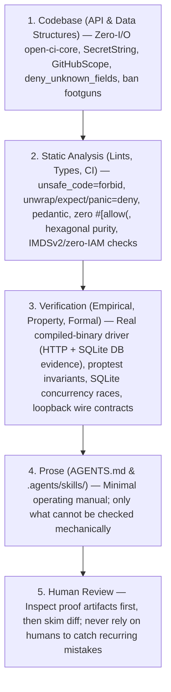

# Engineering Principles & Trust Loop

You don't need a "software factory" — that term is marketing. All you need is good software engineering and investing your verification effort in the right places.

`open-ci` follows the **Loops You Can Trust** engineering model popularized by Lauren Tan (`@poteto`) and the Grok Bot / `pstack` workflows: not blind trust, but investing in the repository's environment — architecture, deterministic static walls, and real empirical verification — so humans and coding agents alike can ship quickly without slop.

---

## The Pyramid of Trust

Every engineering rule is pushed as high up the deterministic stack as possible. Higher layers cost zero ongoing tokens and cannot drift; lower layers are reserved for judgment calls machines cannot make.

1. **Codebase (Level 1 — Strongest Lever):** Good API design, clean crate boundaries, and strict types make invalid states impossible to compile. `open-ci-core` has zero I/O crates in `Cargo.toml`, `SecretString` redacts secrets in `Debug`, `GitHubScope` separates repo vs org API routing, and `#[serde(deny_unknown_fields)]` rejects config typos at parse time.
2. **Static Analysis (Level 2 — Deterministic, Zero Ongoing Tokens):** Workspace Cargo lints (`unsafe_code = "forbid"`, `clippy::unwrap_used = "deny"`, `expect_used = "deny"`, `panic = "deny"`, `pedantic = "warn"`), a hard ban on `#[allow(`, `cargo tree` dependency-graph checks, and shell/Terraform/policy gates catch shortcuts before tests even run. Gate errors explain how to fix the root cause.
3. **Verification (Level 3 — Where Verification Tokens Belong):** Rather than wasting tokens on adversarial agents arguing over diffs, spend verification effort **actually running the system** and hammering its state space:
   - Live compiled-binary driver (`.agents/skills/verify-open-ci/scripts/drive.sh`) asserting **Action → HTTP/Runtime State → SQLite DB Side Effects**.
   - Randomized property tests (`proptest`) in `crates/open-ci-core/tests/invariants.rs`.
   - Real on-disk SQLite WAL concurrency and online backup races (`crates/open-ci-store`).
   - Real loopback TCP/Axum wire-contract tests validating SigV4, XML, OIDC JWKS, Twirp v2, and HMAC bytes (`zero lazy mocks`, `zero #[ignore]`).
4. **Prose (Level 4 — Minimal):** `AGENTS.md` and `.agents/skills/` stay short and concrete. If a rule keeps getting violated, delete the prose reminder and encode it at Level 1, 2, or 3.
5. **Human Review (Level 5 — Proof First, Diff Second):** Reviewers inspect empirical proof artifacts (command outputs, HTTP + SQLite DB transitions, `verify.sh` results) first, then skim the diff for design and threat-model alignment.

---

## Core Operating Principles

### Your Codebase Is Memory
Coding agents pattern-match whatever already exists in the repository. A single band-aid workaround (`sleep`, swallowed error, ad-hoc curl hack, or excuse comment) quickly multiplies across future commits.
- **Stop shipping band-aid quick fixes** — fix root causes and garden bad patterns out of the repo.
- **Keep comments minimal (`no-comments`)** — strip stale, narrating, or workaround inline comments; convert claimed invariants into types, lints, or tests. Keep only concise `///` public Rustdoc and rare non-obvious protocol/OS invariants.

### Goal + Check (No Planning Theater)
The best specification is code plus a falsifiable check. Start every task with a crisp **Goal + Check**:
- For bugs: **repro first → fix root cause → verify**.
- Never weaken a check to make it pass.

### Build the Lever & Stop the Line
- **Do it by hand once, then script the lever:** Once a verification flow proves useful, codify it into `.agents/skills/verify-open-ci/scripts/drive.sh` or `./scripts/verify.sh` so future runs are fast, deterministic, and token-efficient.
- **Stop the Line:** Any failing gate halts execution immediately. Never forward broken work downstream.
- **Inner loop first, outer loop second:** Prove the single-agent verification loop locally before scaling out to parallel `git worktree` runs.

### Maintain Your Verification Harness
Tests and runtime drivers rot when code moves on. Whenever an HTTP route, CLI subcommand, admission mode, cache endpoint, or SQLite table changes, update `.agents/skills/verify-open-ci/features.md`, `.agents/skills/verify-open-ci/scripts/drive.sh`, and `docs/architecture.md` in the same PR.

---

## Focused Skills (`.agents/skills/`)

Coordinated by [`AGENTS.md`](../AGENTS.md), the repository ships 6 focused skills:

| Skill | Purpose |
| --- | --- |
| `open-ci-workflow` | Goal + Check routing (`feature`, `bug-fix`, `refactor`, `autonomous-run`), root-cause discipline, stop-the-line gates, and `git worktree` isolation. |
| `verify-open-ci` | Runs the reusable [`scripts/drive.sh`](../.agents/skills/verify-open-ci/scripts/drive.sh) harness against the real compiled binary, asserting HTTP state + SQLite DB side effects against `features.md`. |
| `prove-invariants` | Writes `proptest` domain invariants, real SQLite concurrency race tests, and loopback Axum wire-contract tests (zero lazy mocks). |
| `encode-correction` | Pushes recurring mistakes up the Pyramid (Codebase → Static Analysis → Verification → Prose), proven red-before-green. |
| `no-comments` | Strips stale/narrating/workaround inline comments, bans footguns, and converts prose claims into mechanical checks. |
| `ship-pr` | Leads PRs with empirical proof artifacts first, enforces clean Conventional Commits, removes AI writing slop, and surfaces `Attention` callouts. |

---

## The 7-Gate Executable Proof Ladder (`./scripts/verify.sh`)

Every change must exit `0` across all 7 gates in `./scripts/verify.sh` (use `./scripts/verify.sh --fast` during inner-loop iteration to skip Gate 4):

| Gate | What It Proves |
| --- | --- |
| **1. Static, Lint & Hexagonal Purity** | `cargo fmt --all -- --check`, `cargo clippy --workspace --all-targets -- -D warnings`, zero `#[allow(` attributes in `crates/`, and `cargo tree -p open-ci-core` confirms zero `tokio`/`reqwest`/`rusqlite`/`axum`/`hyper` dependencies. |
| **2. Domain Invariants, Storage, Wire Contracts & E2E** | `cargo test --workspace` — runs `proptest` domain invariants (`open-ci-core`), real SQLite durability/lock/backup races (`open-ci-store`), loopback AWS/GCP/identity contract tests, cache Twirp + storage tests (`open-ci-cache`), janitor fault-isolation tests, and control-plane lifecycle E2E tests (`open-ci-server`) with zero `#[ignore]`d tests. |
| **3. Offline Config Validation** | `cargo run --quiet --bin open-ci -- validate --config config/open-ci.example.toml` — proves the shipped example config parses cleanly and passes all capacity and trust invariants. |
| **4. Real Compiled-Binary Runtime Proof** | Invokes `.agents/skills/verify-open-ci/scripts/drive.sh`: builds `target/debug/open-ci`, launches `open-ci demo` on an isolated ephemeral loopback port and temp SQLite directory, polls `/healthz` + `/readyz`, drives unauthenticated `401`, authenticated `/api/v1/overview`, Prometheus `/metrics`, live `open-ci ctl set-mode draining`, `/api/v1/audit`, and direct SQLite DB verification (`control_state`, `audit_log`, `PRAGMA integrity_check`), then cleans up. |
| **5. TypeScript Routing Action** | `node --test actions/route/test/route.test.ts` — proves fail-closed fallback on reruns, timeouts, 4xx responses, and malformed payloads. |
| **6. IaC, Packer & Security Policy Invariants** | `terraform fmt -check -recursive infra/terraform`, `bash -n` on `verify.sh`, `drive.sh`, and Packer scripts (`shellcheck` when installed), plus static policy checks enforcing IMDSv2 (`http_tokens = "required"` / `MetadataOptions.HttpTokens = required`) and zero-IAM GCP runners (`"serviceAccounts": []`). |
| **7. Route & Doc Parity** | Extracts every registered Axum route from `crates/open-ci-server/src/http/*.rs` and verifies verbatim presence in `docs/architecture.md`, preventing silent drift between code and docs. |
